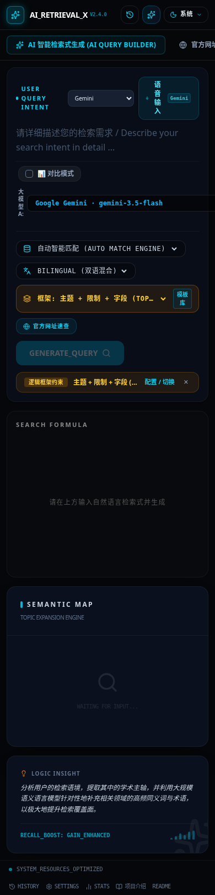
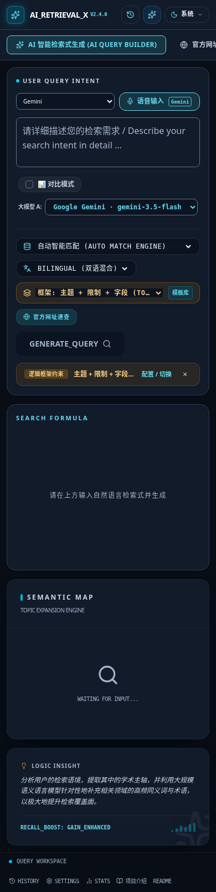
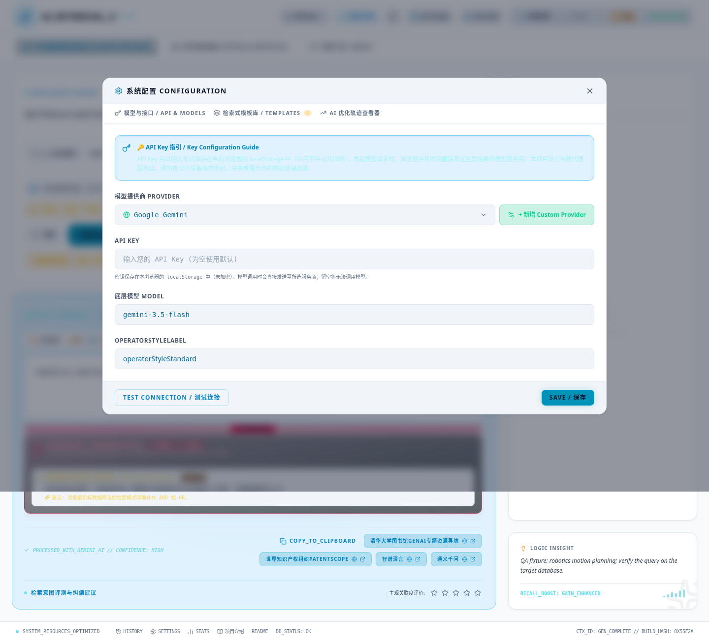
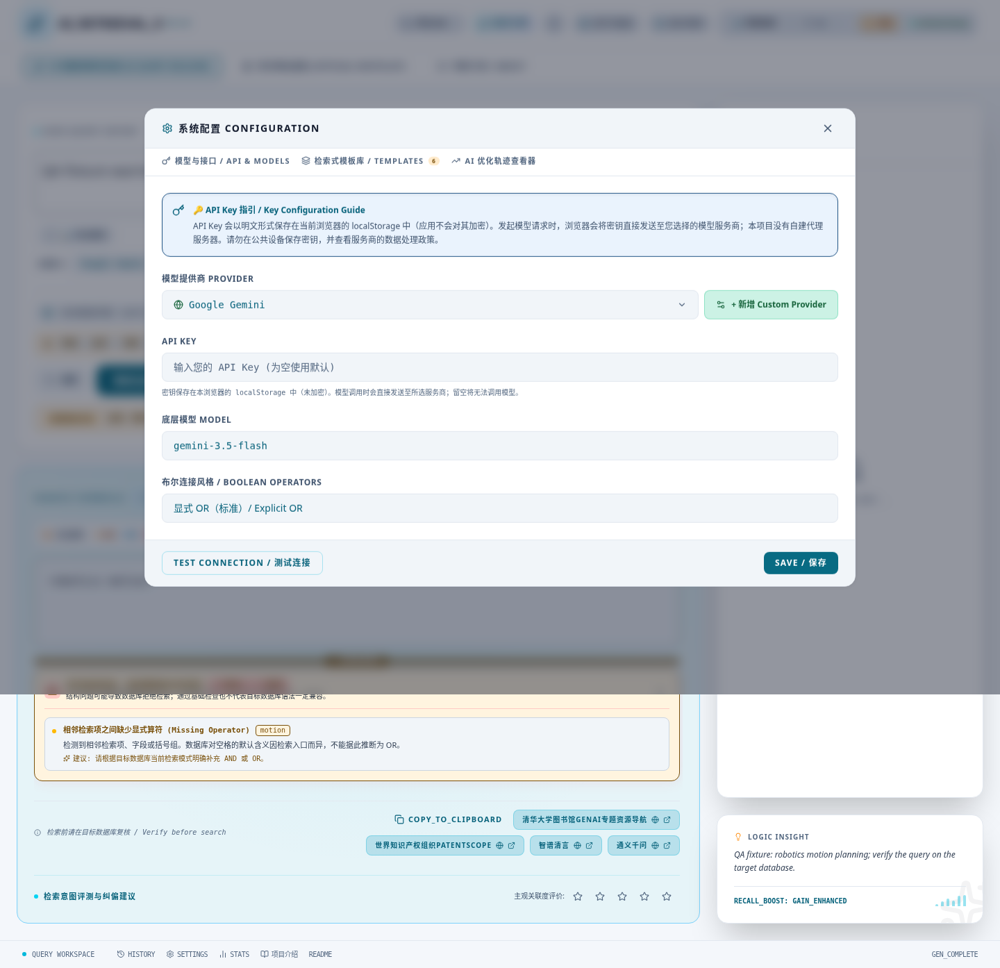

# Before / After Screenshots

Current-run local captures: immutable main `57739e1` before; UI implementation `421c456` with QA script `5e66583` after. The capture starts at the document origin to avoid fixed-element artifacts. Query results are explicitly seeded fixtures, not live AI output. Production capture is BLOCKED; the user authorized local validation.

**58 original PNGs are published. Two Before Whitelist images are withheld** because the old resource labels contained credential-like annotations of unknown validity. No redacted substitute is presented as an original. The After Whitelist captures show the repaired resource name. Before capture runs without axe; its zero counters are not an accessibility pass.

| State | Before | After |
|---|---|---|
| dark-desktop-builder | [PNG](screenshots/before/dark-desktop-builder.png) | [PNG](screenshots/after/dark-desktop-builder.png) |
| dark-desktop-result | [PNG](screenshots/before/dark-desktop-result.png) | [PNG](screenshots/after/dark-desktop-result.png) |
| dark-desktop-keyword-edit | [PNG](screenshots/before/dark-desktop-keyword-edit.png) | [PNG](screenshots/after/dark-desktop-keyword-edit.png) |
| dark-validation-error | [PNG](screenshots/before/dark-validation-error.png) | [PNG](screenshots/after/dark-validation-error.png) |
| dark-warning-only | [PNG](screenshots/before/dark-warning-only.png) | [PNG](screenshots/after/dark-warning-only.png) |
| dark-settings | [PNG](screenshots/before/dark-settings.png) | [PNG](screenshots/after/dark-settings.png) |
| dark-about | [PNG](screenshots/before/dark-about.png) | [PNG](screenshots/after/dark-about.png) |
| dark-whitelist | BLOCKED — privacy | [PNG](screenshots/after/dark-whitelist.png) |
| dark-offline-dialog | [PNG](screenshots/before/dark-offline-dialog.png) | [PNG](screenshots/after/dark-offline-dialog.png) |
| dark-tablet-builder | [PNG](screenshots/before/dark-tablet-builder.png) | [PNG](screenshots/after/dark-tablet-builder.png) |
| dark-tablet-result | [PNG](screenshots/before/dark-tablet-result.png) | [PNG](screenshots/after/dark-tablet-result.png) |
| dark-tablet-keyword-edit | [PNG](screenshots/before/dark-tablet-keyword-edit.png) | [PNG](screenshots/after/dark-tablet-keyword-edit.png) |
| dark-mobile-builder | [PNG](screenshots/before/dark-mobile-builder.png) | [PNG](screenshots/after/dark-mobile-builder.png) |
| dark-mobile-result | [PNG](screenshots/before/dark-mobile-result.png) | [PNG](screenshots/after/dark-mobile-result.png) |
| dark-mobile-keyword-edit | [PNG](screenshots/before/dark-mobile-keyword-edit.png) | [PNG](screenshots/after/dark-mobile-keyword-edit.png) |
| light-desktop-builder | [PNG](screenshots/before/light-desktop-builder.png) | [PNG](screenshots/after/light-desktop-builder.png) |
| light-desktop-result | [PNG](screenshots/before/light-desktop-result.png) | [PNG](screenshots/after/light-desktop-result.png) |
| light-desktop-keyword-edit | [PNG](screenshots/before/light-desktop-keyword-edit.png) | [PNG](screenshots/after/light-desktop-keyword-edit.png) |
| light-validation-error | [PNG](screenshots/before/light-validation-error.png) | [PNG](screenshots/after/light-validation-error.png) |
| light-warning-only | [PNG](screenshots/before/light-warning-only.png) | [PNG](screenshots/after/light-warning-only.png) |
| light-settings | [PNG](screenshots/before/light-settings.png) | [PNG](screenshots/after/light-settings.png) |
| light-about | [PNG](screenshots/before/light-about.png) | [PNG](screenshots/after/light-about.png) |
| light-whitelist | BLOCKED — privacy | [PNG](screenshots/after/light-whitelist.png) |
| light-offline-dialog | [PNG](screenshots/before/light-offline-dialog.png) | [PNG](screenshots/after/light-offline-dialog.png) |
| light-tablet-builder | [PNG](screenshots/before/light-tablet-builder.png) | [PNG](screenshots/after/light-tablet-builder.png) |
| light-tablet-result | [PNG](screenshots/before/light-tablet-result.png) | [PNG](screenshots/after/light-tablet-result.png) |
| light-tablet-keyword-edit | [PNG](screenshots/before/light-tablet-keyword-edit.png) | [PNG](screenshots/after/light-tablet-keyword-edit.png) |
| light-mobile-builder | [PNG](screenshots/before/light-mobile-builder.png) | [PNG](screenshots/after/light-mobile-builder.png) |
| light-mobile-result | [PNG](screenshots/before/light-mobile-result.png) | [PNG](screenshots/after/light-mobile-result.png) |
| light-mobile-keyword-edit | [PNG](screenshots/before/light-mobile-keyword-edit.png) | [PNG](screenshots/after/light-mobile-keyword-edit.png) |

The [manifest](evidence/screenshot-manifest.json) records source and SHA-256 for each published original, and explicitly records each omission. Full-page dialog captures also include page content outside the initial viewport. Keyboard-focus screenshots are retained separately in CI/local QA evidence.

## Mobile layout

## Light settings

